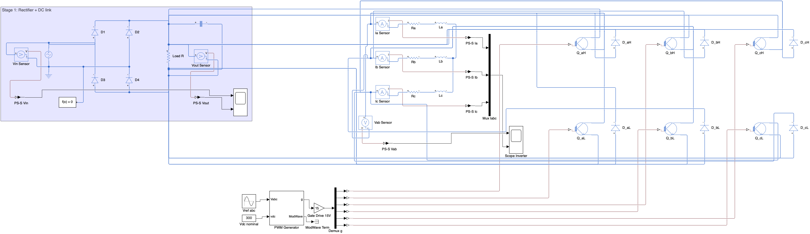
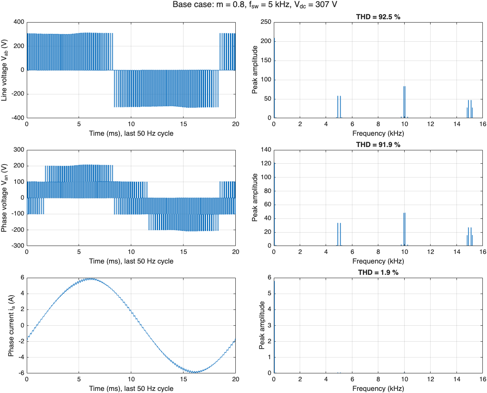
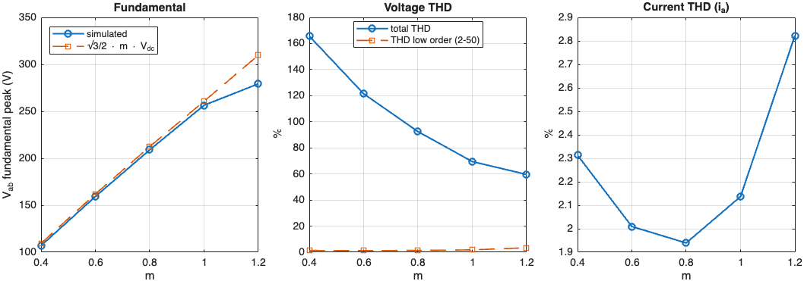
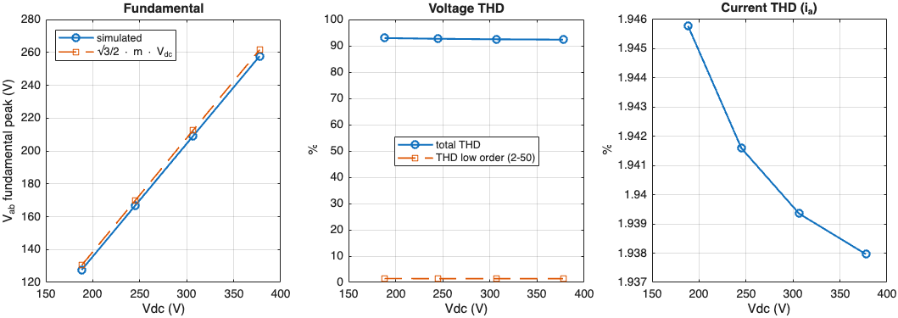
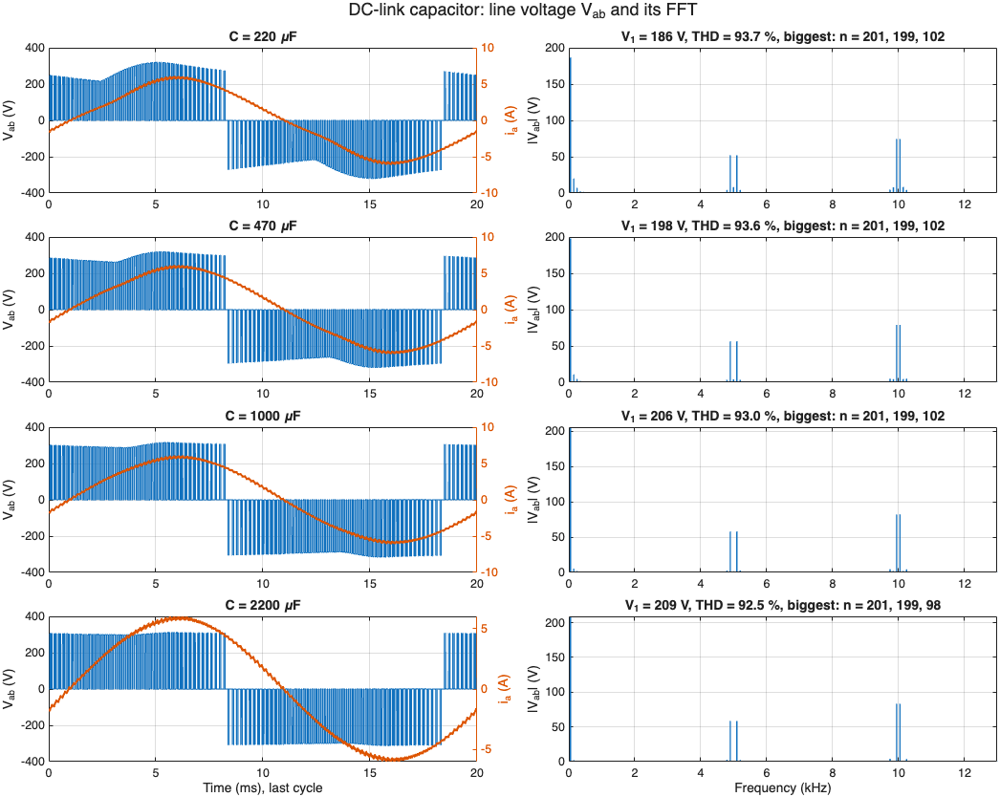
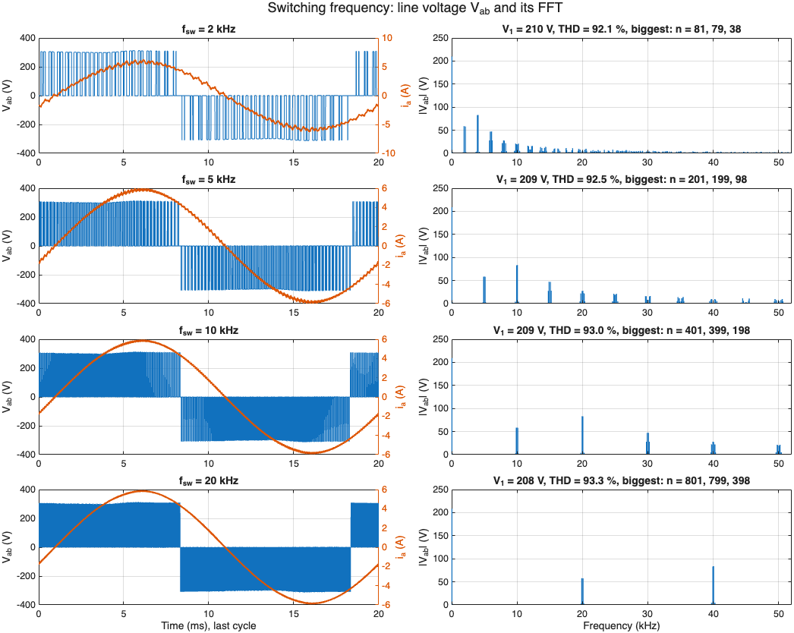
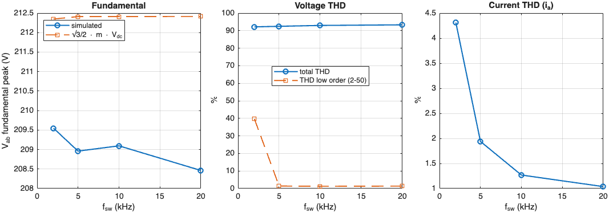

# Harmonic analysis of the VFD inverter

This file explains the studies run by `scripts/run_all_studies.m`. All numbers below come from the 6-switch model at the default operating point:

- 230 V / 50 Hz single-phase supply
- 2200 µF DC link
- m = 0.8 and f<sub>sw</sub> = 5 kHz
- 20 Ω + 20 mH star load

Full tables are in [`results/summary.md`](results/summary.md), and the figures are in [`results/`](results).

## 1. Setup

### Six-switch inverter

`vfd_six_switch.slx` is generated by `scripts/build_six_switch_model.m`. The script removes the Converter (Three-Phase) block and builds the two-level bridge from **6 × IGBT (Ideal, Switching)** blocks. Each IGBT has an anti-parallel freewheeling diode.

```
 DC+ ──┬─────────┬─────────┐
     Q_aH‖D    Q_bH‖D    Q_cH‖D
       ├─ a      ├─ b      ├─ c   ──> star RL load (floating neutral)
     Q_aL‖D    Q_bL‖D    Q_cL‖D
 DC- ──┴─────────┴─────────┘
```

- The upper and lower IGBT of a leg get complementary 15 V gate pulses. The gate threshold is 6 V.
- The 6-switch model gives the same results as the original Converter block. For example, the 50 Hz phase current is 5.80 A against 5.83 A. The small difference comes from the 0.8 V diode drops.



### Modulation

Sinusoidal PWM (SPWM) is used. A 50 Hz sine reference is compared with a triangular carrier at f<sub>sw</sub>.

- Modulation index: m = V<sub>ref,peak</sub> / (V<sub>dc,nom</sub>/2), with V<sub>dc,nom</sub> = 300 V.
- Frequency ratio: m<sub>f</sub> = f<sub>sw</sub>/f<sub>1</sub>. This is 100 at 5 kHz.

### FFT (`scripts/my_fft.m`)

1. The variable-step output is resampled at 2 MHz.
2. The last 0.1 s is taken. That is exactly 5 cycles, so the resolution is 10 Hz and every harmonic falls on an FFT bin.
3. `X = fft(x)/N` gives the two-sided spectrum. The single-sided peak amplitude is 2·|X|.
4. **Total THD** is computed from RMS values: √(V<sub>rms</sub>² − V<sub>dc</sub>² − V<sub>1,rms</sub>²) / V<sub>1,rms</sub>. This means no frequency cut-off is needed.
5. **THD 2-50** uses only harmonic orders 2–50 (the low-order harmonics that are hard to filter).

The PWM sample time and the solver max step are set to 1/(200·f<sub>sw</sub>), and never above 2 µs. Every carrier period therefore has at least 200 points. Without this, the 20 kHz case shows fake low-order distortion.

## 2. Base case: which harmonics are in the output voltage



| Signal | Fundamental (peak) | Total THD | Largest harmonics |
|---|---|---|---|
| Line voltage V<sub>ab</sub> | 209 V (theory √3/2·m·V<sub>dc</sub> = 212 V) | 92.5 % | 199 & 201 (40 %), 98 & 102 (28 %), 298 & 302 (23 %) |
| Phase voltage V<sub>an</sub> | 121 V (theory m·V<sub>dc</sub>/2 = 123 V) | ≈ 90 % | same orders |
| Phase current i<sub>a</sub> | 5.80 A | 1.9 % | tiny sidebands + 150 Hz |

**Line voltage:**

- The harmonics appear as **sideband clusters** at n = j·m<sub>f</sub> ± k:
  - Around m<sub>f</sub> = 100: orders **98 and 102** (k = ±2).
  - Around 2m<sub>f</sub>: orders **199 and 201** (k = ±1).
  - Around 3m<sub>f</sub>: orders **298 and 302**, and so on.
- **Order 100 itself (the carrier) is missing.** The carrier component of each leg is the same in all three phases (zero-sequence), so it cancels in the line voltage.

**Phase voltage:** with a floating star point, the carrier component also cancels in the load phase voltage. The waveform has 5 levels (0, ±V<sub>dc</sub>/3, ±2V<sub>dc</sub>/3).

**Low-order harmonics (orders 2–50):** these are almost zero (1.4 %). What remains is mostly the **3rd (150 Hz)**, which comes from the DC-link ripple (see §4).

**Current:** the load reactance ωL is 6.3 Ω at 50 Hz but 616 Ω at 4.9 kHz. So the voltage harmonics drive very little current, and the current THD is only ~2 %.

## 3. Changing the sine magnitude (modulation index m)



| m | V<sub>ab1</sub> sim / theory (V) | V<sub>ab</sub> THD | THD 2-50 | Biggest cluster | i<sub>a</sub> THD |
|---|---|---|---|---|---|
| 0.4 | 107 / 109 | 166 % | 1.4 % | 199/201 (83 %) | 2.3 % |
| 0.6 | 159 / 162 | 122 % | 1.2 % | 199/201 (63 %) | 2.0 % |
| 0.8 | 209 / 212 | 93 % | 1.4 % | 199/201 (40 %) | 1.9 % |
| 1.0 | 256 / 261 | 70 % | 1.8 % | 98/102 (32 %) | 2.1 % |
| 1.2 | 279 / **310** | 60 % | **3.4 %** (5th = 2.6 %) | 98/102 (31 %) | 2.8 % |

**For m ≤ 1 (linear range):**

- The fundamental follows **(√3/2)·m·V<sub>dc</sub>**. The simulation is 1–2 % lower because of the switch and diode drops.
- The total voltage THD **falls** as m rises, because the fundamental grows while the pulse height (V<sub>dc</sub>) stays the same.
- The energy shifts between the clusters. At low m, the 2m<sub>f</sub> cluster (199/201) dominates. At m = 1, the m<sub>f</sub> cluster (98/102) is larger.

**At m = 1.2 (overmodulation):**

- The reference exceeds the carrier, so pulses get dropped.
- The fundamental is only 279 V, against 310 V if it were linear.
- **Low-order harmonics (5th, 3rd, 11th) appear.** They are close to 50 Hz, so they cannot be filtered easily. In a motor they would cause torque ripple.

## 4. Changing the DC link

### a) DC-link voltage

The supply amplitude is changed, which changes V<sub>dc</sub>.



| V<sub>dc</sub> (V) | V<sub>ab1</sub> (V) | V<sub>ab</sub> THD | i<sub>a1</sub> (A) | i<sub>a</sub> THD |
|---|---|---|---|---|
| 188 | 128 | 92.9 % | 3.54 | 1.95 % |
| 245 | 167 | 92.7 % | 4.63 | 1.94 % |
| 307 | 209 | 92.5 % | 5.80 | 1.94 % |
| 378 | 258 | 92.3 % | 7.15 | 1.94 % |

- The PWM block still assumes 300 V, so m stays 0.8.
- The output voltage and current are **directly proportional to V<sub>dc</sub>**. Every harmonic scales by the same factor, so the **THD and the harmonic orders do not change**.
- In a real drive, V<sub>dc</sub> is measured and m is corrected to keep the output constant (DC-bus voltage compensation).

### b) DC-link capacitor (ripple)



| C (µF) | V<sub>dc</sub> ripple (V p-p) | V<sub>dc</sub> avg (V) | THD 2-50 | 3rd / 5th harmonic | i<sub>a</sub> THD |
|---|---|---|---|---|---|
| 220 | 104 | 273 | **11.5 %** | 10.7 % / 3.8 % | **7.4 %** |
| 470 | 57 | 293 | 6.1 % | 5.5 % / 2.3 % | 4.4 % |
| 1000 | 29 | 303 | 2.9 % | 2.6 % / 1.1 % | 2.7 % |
| 2200 | 13 | 307 | 1.4 % | 1.2 % / 0.4 % | 1.9 % |

- A single-phase bridge charges the capacitor twice per cycle, so V<sub>dc</sub> has a **100 Hz ripple**. The ripple roughly halves every time C doubles.
- The output is the switching function × V<sub>dc</sub>. So a 100 Hz ripple modulates the 50 Hz output and creates **150 Hz (3rd)** and **250 Hz (5th)** components. These are low-order harmonics that the PWM cannot remove.
- With 220 µF, the 3rd harmonic is 10.7 % and the current THD rises to 7.4 %. This is why single-phase-fed drives need a large DC-link capacitor (or active ripple compensation).

## 5. Changing the switching frequency




| f<sub>sw</sub> | m<sub>f</sub> | First cluster | Second cluster | V<sub>ab</sub> THD | THD 2-50 | i<sub>a</sub> THD |
|---|---|---|---|---|---|---|
| 2 kHz | 40 | 38/42 | 79/81 | 92.1 % | **39.6 %** | **4.3 %** |
| 5 kHz | 100 | 98/102 | 199/201 | 92.5 % | 1.4 % | 1.9 % |
| 10 kHz | 200 | 198/202 | 399/401 | 93.0 % | 1.3 % | 1.3 % |
| 20 kHz | 400 | 398/402 | 799/801 | 93.3 % | 1.4 % | 1.0 % |

**What changes in the FFT:**

- The **sideband clusters move with f<sub>sw</sub>**. They always sit at m<sub>f</sub> ± 2, 2m<sub>f</sub> ± 1, 3m<sub>f</sub> ± 2, … with the **same relative sizes** (28 %, 40 %, 23 %).
- The **total voltage THD stays about 92–93 %**. The pulse pattern carries the same energy, only finer in time.
- The **current THD drops** (4.3 → 1.9 → 1.3 → 1.0 %) because the harmonics move to frequencies where ωL is larger.
  - Above 10 kHz it flattens out. The remaining distortion is the 150 Hz from the DC ripple, and raising f<sub>sw</sub> cannot remove that.
- At **2 kHz**, the first cluster (38/42) falls inside the "low-order" range. These harmonics are only 1.9 kHz from the fundamental, so they are harder to filter and the current ripple is clearly visible.

**Cost:** switching losses grow ∝ f<sub>sw</sub>. So the choice is a trade-off between current quality (and noise) and efficiency.

## 6. Summary

| Change | Fundamental | Harmonic orders | Voltage THD | Current THD |
|---|---|---|---|---|
| m ↑ (≤ 1) | ∝ m | same clusters | ↓ | ≈ same |
| m > 1 | saturates | + 3rd, 5th, 7th, 11th | ↓ total, ↑ low-order | ↑ |
| V<sub>dc</sub> ↑ | ∝ V<sub>dc</sub> | same | same | same |
| C ↓ (more ripple) | slightly ↓ | + 3rd, 5th | ↑ low-order | ↑↑ |
| f<sub>sw</sub> ↑ | same | clusters move to m<sub>f</sub>, 2m<sub>f</sub>, … | same | ↓ |
