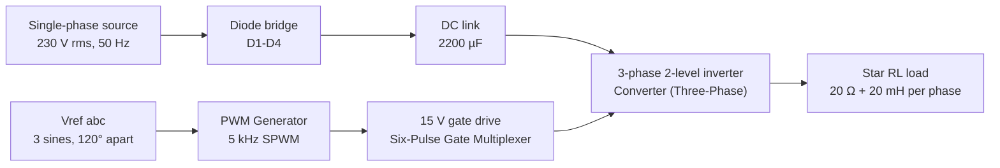
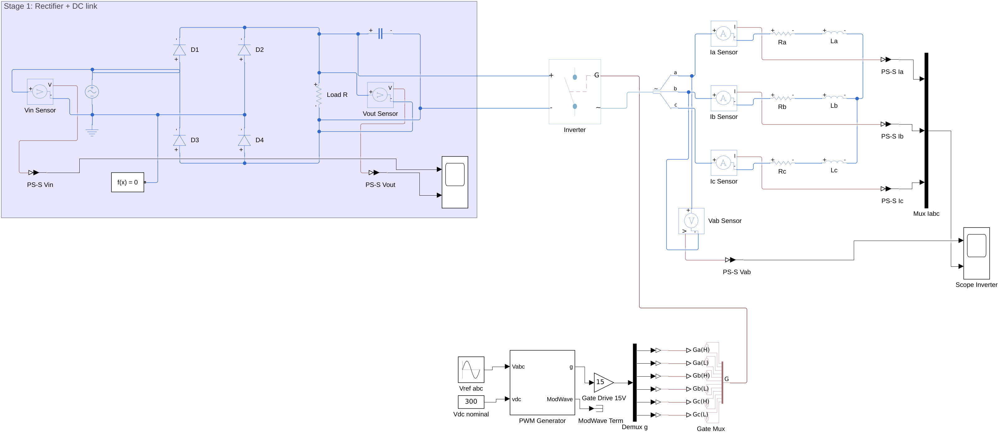
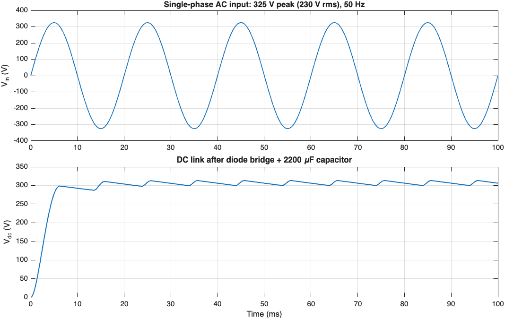
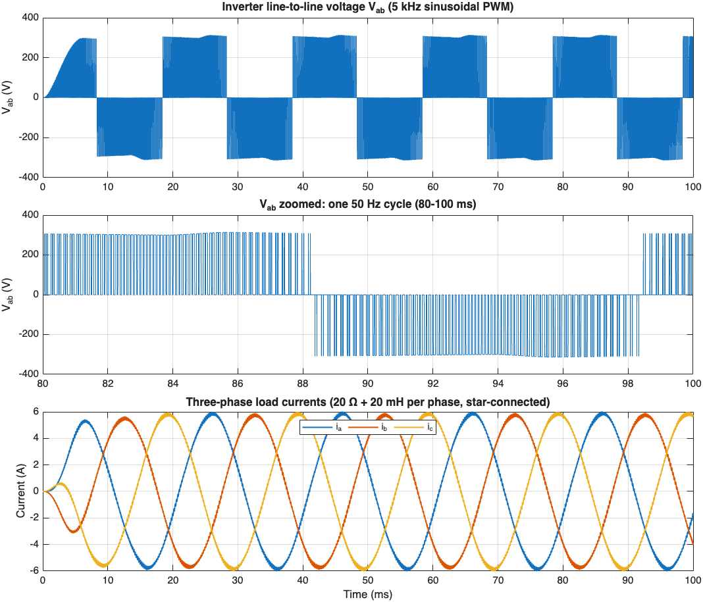

# Simscape-VFD: Single-Phase to Three-Phase Converter

A MATLAB/Simulink + Simscape Electrical model of the power stage of a variable-frequency drive (VFD). It converts a **single-phase 230 V rms, 50 Hz** supply into **balanced three-phase AC**:

1. A **diode bridge** rectifies the AC.
2. A **DC-link capacitor** smooths it.
3. A **two-level three-phase inverter**, driven by **sinusoidal PWM**, switches the DC into three phases.



## Model



The shaded area on the left is **Stage 1: rectifier + DC link**. Everything to the right of it is **Stage 2: inverter, gating, load and measurements**.

### Stage 1: Rectifier and DC link

| Part | Block | Settings |
|---|---|---|
| AC supply | Simscape `AC Voltage Source` | 325 V peak (230 V rms), 50 Hz. Its − terminal is the circuit's **only** ground. |
| Bridge | 4 × Simscape Foundation `Diode` (D1–D4) | Piecewise linear: V<sub>f</sub> = 0.6 V, R<sub>on</sub> = 0.3 Ω |
| DC link | `Capacitor` | 2200 µF |
| DC-side resistor | `Resistor` (Load R) | 100 Ω, left over from the rectifier-only test; optional |
| Measurements | Voltage sensors → PS-Simulink converters → `Scope` | Vin and Vdc |

### Stage 2: Inverter, gating and load

| Part | Block | Settings |
|---|---|---|
| Inverter | Simscape Electrical `Converter (Three-Phase)` | Detailed model, ideal semiconductor switches (R<sub>on</sub> = 1 mΩ, gate threshold 6 V) |
| Reference | `Sine Wave` (Vref abc) | 120 V peak, 50 Hz, phases `[0 -2*pi/3 2*pi/3]` |
| DC voltage used by the PWM | `Constant` (Vdc nominal) | 300 V, so modulation index m = 120 / (300/2) = **0.8** |
| Modulator | `PWM Generator (Three-phase, Two-level)` | Continuous sinusoidal PWM, natural sampling, f<sub>sw</sub> = 5 kHz, T<sub>s</sub> = 2 µs |
| Gate drive | `Gain` = 15 → `Demux` → 6 × Simulink-PS → `Six-Pulse Gate Multiplexer` | Turns the 0/1 PWM pulses into 15 V gate signals: Ga(H), Ga(L), Gb(H), Gb(L), Gc(H), Gc(L) |
| Load | `Phase Splitter` + 3 × (current sensor, 20 Ω, 20 mH) | Star-connected, **floating neutral** |
| Measurements | Vab sensor, Ia/Ib/Ic sensors → `Scope Inverter` | |

**Solver:** `ode23t` (variable step), max step size 2 µs, stop time 0.1 s. One run takes about 7 s.

## Results

### Rectifier and DC link



### Inverter output



### Steady-state numbers (one 50 Hz cycle, 80–100 ms)

| Quantity | Simulated | Expected |
|---|---|---|
| DC-link voltage | 300–313 V (average 306.6 V) | ≈ 325 V minus diode drops, with 100 Hz ripple under load |
| Phase current, 50 Hz part (peak) | I<sub>a</sub> 5.84 A, I<sub>b</sub> 5.78 A, I<sub>c</sub> 5.85 A | 0.8 × 306.6/2 ÷ \|20 + j6.28\| Ω ≈ **5.85 A** |
| Phase of I<sub>b</sub> and I<sub>c</sub> relative to I<sub>a</sub> | −119°, +121° | ±120° |
| Line voltage V<sub>ab</sub> | PWM pulses at about ±V<sub>dc</sub> | Two-level SPWM |
| i<sub>a</sub> + i<sub>b</sub> + i<sub>c</sub> | ≈ 0 (about 1e-12 A) | 0, because the neutral floats |

The first one or two cycles are a start-up transient while the DC-link capacitor charges from 0 V.


## Repository layout

```
.
├── single_phase_to_three_phase.slx   # Simulink / Simscape model
├── images/
│   ├── model.png                     # model diagram
│   ├── rectifier_dc_link.png         # Vin and Vdc waveforms
│   └── inverter_output.png           # Vab (full + zoom) and Ia/Ib/Ic
└── scripts/
    └── plot_results.m                # re-simulates and regenerates the figures
```
